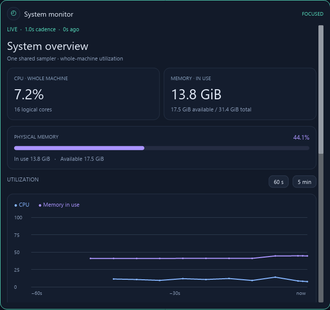
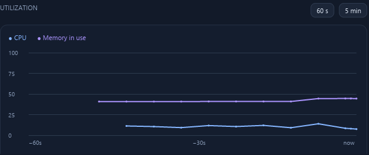

# Tervix

**Нативный терминал и tiling-среда разработчика для Windows.**

PowerShell, cmd, WSL и SSH, мониторинг системы и Docker — в панелях, которые можно
разделять, растягивать и перемещать. Rust 2024 · Iced/WGPU · Apache-2.0.

> **Preview, не стабильный релиз.** Рабочие пространства и настройки пока не
> сохраняются между запусками. Производительность и полная матрица совместимости
> ещё не подтверждены. Доступность release artifacts зависит от ручного выпуска.

## Возможности

| Инструмент | Что доступно |
| --- | --- |
| Терминалы | ConPTY, PowerShell/cmd, ANSI/Unicode, независимые сессии, resize |
| WSL | Обнаружение и выбор дистрибутива, явный запуск/замена сессии |
| SSH | Системный OpenSSH, host/alias, пользователь и порт, явный Connect |
| Docker | Контейнеры, поиск/сортировка, inspect/stats, подтверждаемые действия |
| Docker logs | Live stdout/stderr, фильтры, pause/follow, bounded history, copy |
| Docker exec | Интерактивный sh/bash через Engine API; close означает detach |
| Мониторинг | CPU/per-core, RAM/pagefile, графики, read-only список процессов |
| Раскладка | Вложенные split, drag/drop, resize, swap, bounded undo |
| Интерфейс | RU/EN, GPU renderer, собственная рамка, reduced motion, solid background |

Разные инструменты и несколько экземпляров одного инструмента можно размещать
в любом месте раскладки. Docker Desktop подключается явно через Windows named pipe.
Независимый Docker daemon внутри WSL и remote contexts пока не поддерживаются.

## Установка и запуск

**Целевая система:** Windows 11 x64, графический адаптер/драйвер, совместимый с
WGPU DX12/Vulkan. Возможен выбор системного software adapter; наличие WGPU не
является обещанием измеренного FPS. Приложение не требует elevation по умолчанию.

Для Windows x64 скачайте `tervix-v<VERSION>-windows-x64-Setup.exe` со страницы
релиза, запустите его и выберите папку установки. После установки откройте
Tervix из меню «Пуск». Для запуска без установки доступен отдельный
`tervix-v<VERSION>-windows-x64.exe`.
Для Linux x86-64 скачайте бинарник, архив `.tar.gz` или пакет `.deb` со страницы
[Releases](https://github.com/levanart/tervix/releases).
Архив сохраняет право на запуск. Для отдельно скачанного бинарника выполните
`chmod +x <файл>`. Контрольные суммы доступны в `SHA256SUMS.txt`.

Пакеты пока **не подписаны Authenticode**; checksum не заменяет цифровую подпись.
PowerShell 7, WSL с дистрибутивом, OpenSSH и Docker устанавливаются отдельно по
мере необходимости. При запуске выбирается pwsh → Windows PowerShell → cmd.

### Сборка из исходников

Нужны Rust **1.89+** и Visual Studio C++ Build Tools с Windows SDK.

```powershell
cargo build --release --locked -p tervix
.\target\release\tervix.exe
```

## Быстрый старт

- **Новый терминал** (`Ctrl+Alt+N`) создаёт панель справа или снизу: PowerShell,
  cmd, выбранный WSL-дистрибутив или неподключённую SSH-форму.
- В разделе **Инструменты** доступны мониторинг, процессы, Docker, настройки и Help.
- **Изменить раскладку** (`Ctrl+Alt+E`) включает resize и перемещение за handle
  заголовка: центр цели — обмен, край — размещение рядом. Esc отменяет перенос.
- Настройки приложения отделены от раскладки. Язык, фон и reduced motion действуют
  на текущую сессию; SSH/WSL настраиваются прямо в своих панелях.
- В Docker выберите endpoint и **Подключить**, затем контейнер. Логи, сведения
  и терминал открываются в отдельных панелях. Закрытие exec не гарантирует
  завершение удалённой оболочки — для этого выполните `exit`.

| Комбинация | Действие |
| --- | --- |
| `Ctrl+Alt+N` | Добавить терминал или инструмент |
| `Ctrl+Alt+E` | Редактирование раскладки / Готово |
| `Ctrl+Alt+Arrows` | Фокус соседней панели |
| `Ctrl+Alt+Shift+Arrows` | Resize в режиме редактирования |
| `Ctrl+Alt+Z` | Undo раскладки |
| `Ctrl+Alt+W` | Закрыть панель, с подтверждением активной сессии |
| `Ctrl+Shift+V` | Вставить; multiline/control text требует подтверждения |
| `Alt+F4` | Закрыть рабочую область с подтверждением активных оболочек |

## Скриншоты

Реальные скриншоты **предыдущей preview-ревизии**: панель мониторинга и графики.
Это не макеты; текущие RU/EN-подписи, палитра и компоновка уже изменены.
Терминальная область с локальными командами и путями исключена при обрезке.





Свежие полнооконные скриншоты нужно обновить перед публикацией. Инструкция для
захвата **уже открытого** окна без кликов и переключения фокуса:
[assets/screenshots](assets/screenshots/README.md).

## Ограничения preview

- Одно native window; native tabs, cross-window docking, drag auto-scroll и
  сохранение/восстановление workspace впереди.
- Selection/copy/search терминального буфера, terminal mouse reporting, полный
  IME/TUI/HiDPI/accessibility acceptance и performance/soak ещё не завершены.
- Docker live acceptance зависит от доступного daemon; тестовый named-pipe сервер
  не заменяет проверку Docker Desktop. После EOF/reconnect logs нужна явная подписка.
- SSH не хранит ключи и пароли; использует конфигурацию и host verification OpenSSH.
- Undo восстанавливает layout/ID, но не завершённые процессы. Требуется явный Restart.
- OSC 52 и автоматическое открытие терминальных ссылок отключены.

## Разработка и выпуск

```powershell
cargo fmt --all -- --check
cargo clippy --locked --workspace --all-targets --all-features -- -D warnings
cargo test --locked --workspace
cargo check --locked --workspace
cargo doc --locked --workspace --no-deps
python -m unittest discover -s scripts -p "test_*.py"
python assets/icons/generate.py --check
```

Headless UI tests требуют доступного WGPU adapter, но не открывают окно. Opt-in
тесты Docker/WSL требуют соответствующих компонентов. Тесты desktop automation
вручную запускайте только в выделенной среде: они мешают обычной работе.

Релиз запускается вручную из `main`. Workflow ставит тег версии на выбранный
коммит, собирает Windows x64 и Linux x86-64 и публикует файлы в GitHub Releases.
Локальный терминал доступен на Windows.
[Процедура выпуска](RELEASE.md) ·
[Release notes](RELEASE_NOTES.md) · [Review готовности](REVIEW.md) ·
[Безопасность](SECURITY.md) · [Лицензия](LICENSE).

Внутренние спецификации, ADR и агентные промпты не являются частью публичного
руководства; новые файлы этих категорий исключены через `.gitignore`.
